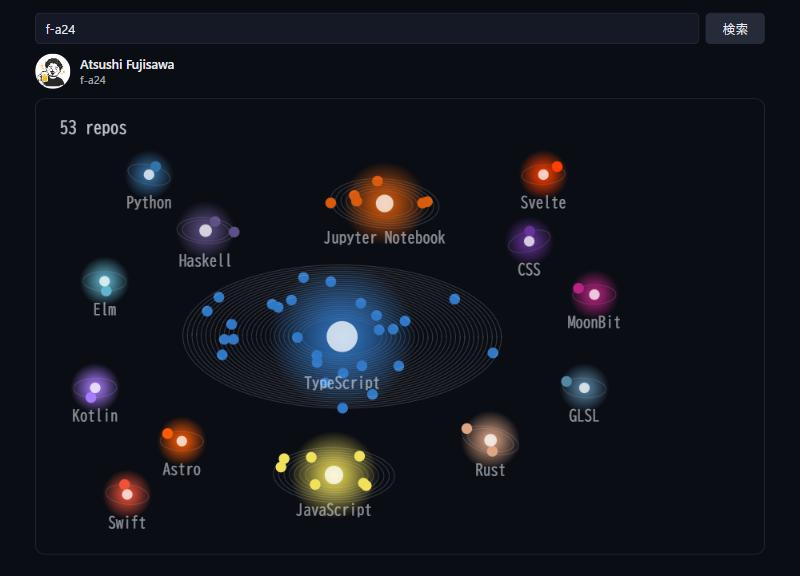

# gh-lg-search

GitHub のユーザー名を入力すると、そのユーザーの公開リポジトリの言語構成を「言語の惑星系」として描く Web アプリです。
言語が恒星、リポジトリが惑星になり、どの言語が中心か・どれだけ幅広い言語に触れてきたかを一目で見られます。

**公開URL**: https://f-a24.github.io/gh-lg-search/ （`?user=ユーザー名` で直接開けます）



## 見かた

- **恒星** = 言語。リポジトリが多い言語ほど大きく光ります。色は GitHub Linguist の言語色です
- **惑星** = リポジトリ。内側の軌道ほど古いリポジトリで、外側ほどゆっくり公転します
- 惑星にカーソルを合わせる（タッチ端末ではタップする）と、リポジトリ名・言語・作成年が出ます。クリックすると GitHub のページを開きます
- 恒星にカーソルを合わせると、その言語のリポジトリ数と割合が出ます
- 集計はリポジトリ数ベースです（各リポジトリの主要言語を1件と数えます。fork と言語不明のものは除きます）
- 動きを減らす設定（`prefers-reduced-motion`）のときは公転せず、静止画で表示します

GitHub の未認証 API を使うため、1時間あたりのリクエスト数に上限があります。上限に達すると、再開できる時刻を表示します。

## 技術スタック

- [MoonBit](https://www.moonbitlang.com/)（JS バックエンド）
- [Rabbita](https://github.com/moonbit-community/rabbita) — 画面（Elm アーキテクチャ）
- [Warren](https://github.com/moonbit-community/rabbita/tree/main/warren) — 開発サーバーとビルド
- Canvas 2D — 惑星系の描画
- GitHub REST API — ユーザー情報とリポジトリの取得
- GitHub Actions + GitHub Pages — デプロイ（静的ファイルのみ）

### パッケージ構成

| パッケージ | 役割 |
|---|---|
| `src/domain` | データモデルと集計（純粋関数） |
| `src/linguist` | 言語色の表（`tools/gen_linguist.mbtx` で生成） |
| `src/layout` | 恒星の配置（純粋関数） |
| `src/orbit` | 惑星の軌道と時刻 t での位置（純粋関数） |
| `src/render` | Canvas への描画 |
| `src/source` | GitHub API からの取得 |
| `src/ffi` | ブラウザ API の FFI（`extern "js"` はここだけ） |
| `src/main` | 画面・状態・インタラクション |

## 開発

MoonBit のツールチェーンと Warren が必要です。

```sh
moon update
moon install moonbit-community/warren
```

```sh
warren dev --browser-entry src/main     # 開発サーバー（http://localhost:4300）
moon check                              # 型チェック
moon test                               # テスト（ネットワークには依存しません。実データは fixtures/）
moon fmt                                # 整形
warren build --browser-entry src/main   # 本番ビルド → dist/
```

`main` ブランチに push すると、GitHub Actions がテストとビルドを行い、GitHub Pages に公開します（`.github/workflows/pages.yml`）。

言語色の表を更新する手順は `tools/gen_linguist.mbtx` の先頭にあります。
